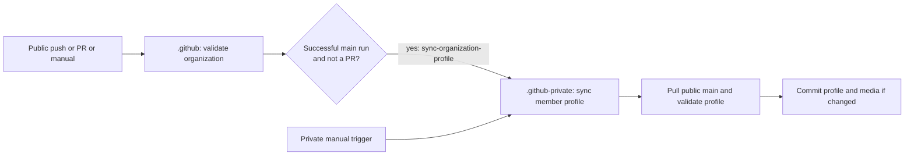
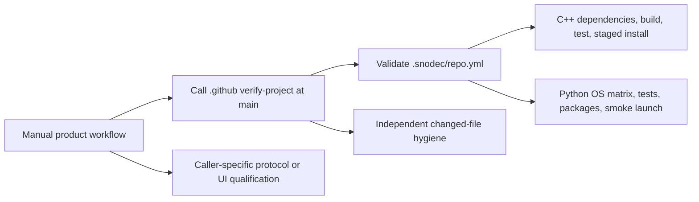
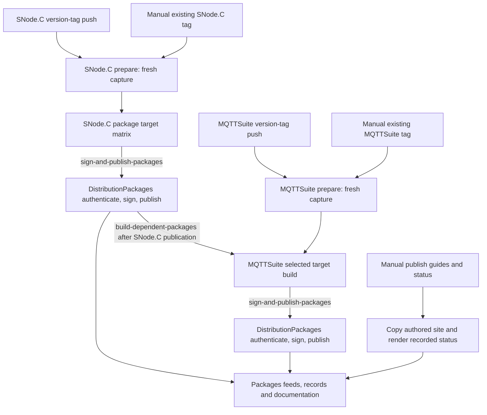
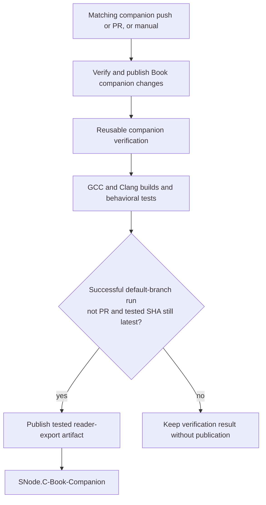
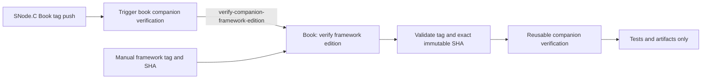
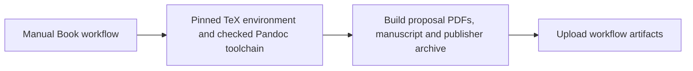

<!-- snodec:begin page-header -->

<picture><source media="(max-width: 640px)" srcset="media/nav/banner-workflows-compact.svg"></picture>

<a href="../README.md#banner" title="Up to SNode.C"><picture><source media="(prefers-color-scheme: dark)" srcset="media/nav/up-snodec-dark.svg"></picture></a><a href="https://github.com/VolkerChristian#banner" title="Volker Christian account"><picture><source media="(max-width: 640px) and (prefers-color-scheme: dark)" srcset="media/nav/account-icon-dark.svg"><source media="(max-width: 640px)" srcset="media/nav/account-icon-light.svg"><source media="(prefers-color-scheme: dark)" srcset="media/nav/account-dark.svg"></picture></a><a href="https://github.com/SNodeC#banner" title="SNode.C organization"><picture><source media="(max-width: 640px) and (prefers-color-scheme: dark)" srcset="media/nav/organization-icon-dark.svg"><source media="(max-width: 640px)" srcset="media/nav/organization-icon-light.svg"><source media="(prefers-color-scheme: dark)" srcset="media/nav/organization-dark.svg"></picture></a><a href="../README.md#banner" title="SNode.C repository"><picture><source media="(max-width: 640px) and (prefers-color-scheme: dark)" srcset="media/nav/repository-icon-dark.svg"><source media="(max-width: 640px)" srcset="media/nav/repository-icon-light.svg"><source media="(prefers-color-scheme: dark)" srcset="media/nav/repository-dark.svg"></picture></a> 

<!-- snodec:end page-header -->

# SNode.C workflow graph

This guide describes the current workflow entry points, repository handoffs and publication boundaries. Workflow YAML and the invoked scripts remain the executable authority. Repository operational guides provide detailed build and release procedures. The inventory was checked against default branches on 14 October 2026.

## Trigger contracts

| Mechanism | Use here | Execution boundary |
| --- | --- | --- |
| `push` / `pull_request` | Repository changes selected by branch, tag and path filters | A new run in that repository; merging a PR produces a push to the destination branch |
| `repository_dispatch` | Named interrepository requests with `client_payload` | A new receiver run using its default-branch workflow; the payload selects and validates source revisions |
| `workflow_dispatch` | Deliberate manual operation | A new run on the selected ref; inputs are specific to the workflow |
| `workflow_call` | Reuse a verification implementation | Jobs execute within the caller's run; it is not a separate interrepository notification |

A README push does not imply a build. The manual product verification workflows have no push or PR trigger. A dispatch requests work; it does not prove successful publication. The signing receiver validates the originating run and artifacts before publishing.

## Workflow inventory

File links point to the current workflow definitions. “Sends/calls” distinguishes another run from reusable jobs within the same run.

| Repository | Workflow file and name | Triggered by | Sends/calls | Effect |
| --- | --- | --- | --- | --- |
| .github | [validate-organization.yml](https://github.com/SNodeC/.github/blob/main/.github/workflows/validate-organization.yml) — Validate organization catalog and profile | Any push, PR, manual | `sync-organization-profile` → .github-private after successful main push/manual run | Catalog, profile and generator checks |
| .github | [verify-project.yml](https://github.com/SNodeC/.github/blob/main/.github/workflows/verify-project.yml) — Reusable build, test and package verification | `workflow_call` only | No dispatch | Manifest-driven C++ or Python verification and artifacts |
| .github-private | [sync-member-profile.yml](https://github.com/SNodeC/.github-private/blob/main/.github/workflows/sync-member-profile.yml) — Sync member organization profile | `sync-organization-profile`; manual | No dispatch | Pull and validate public main; commit changed member profile/media |
| snode.c | [build-and-test.yml](https://github.com/SNodeC/snode.c/blob/master/.github/workflows/build-and-test.yml) — Build and test SNode.C | Manual only | Calls .github `verify-project.yml@main` | Build, tests and staged-install verification |
| snode.c | [build-distribution-packages.yml](https://github.com/SNodeC/snode.c/blob/master/.github/workflows/build-distribution-packages.yml) — Build SNode.C distribution packages | Version-tag push; manual existing-tag start on default branch; `build-dependent-packages` receiver retained for future use, currently unused | `sign-and-publish-packages` → DistributionPackages per successful target | Capture sources and recipes; build unsigned packages and logs |
| snode.c | [trigger-book-companion-verification.yml](https://github.com/SNodeC/snode.c/blob/master/.github/workflows/trigger-book-companion-verification.yml) — Trigger book companion verification | Non-deleted `Book-*` tag push | `verify-companion-framework-edition` → SNode.C-Book | Request verification of framework tag/SHA |
| mqttsuite | [build-and-test.yml](https://github.com/SNodeC/mqttsuite/blob/master/.github/workflows/build-and-test.yml) — Build and test MQTTSuite | Manual only | Calls .github `verify-project.yml@main` | Build and tests |
| mqttsuite | [build-distribution-packages.yml](https://github.com/SNodeC/mqttsuite/blob/master/.github/workflows/build-distribution-packages.yml) — Build MQTTSuite distribution packages | Version-tag push; manual existing-tag start on default branch; `build-dependent-packages` from DistributionPackages | `sign-and-publish-packages` → DistributionPackages per successful target | Build unsigned packages against the selected published framework |
| DistributionPackages | [sign-and-publish-packages.yml](https://github.com/SNodeC/DistributionPackages/blob/main/.github/workflows/sign-and-publish-packages.yml) — Sign and publish distribution packages | `sign-and-publish-packages` only | After SNode.C publication: `build-dependent-packages` → mqttsuite | Authenticate artifacts; sign, publish feeds and update recorded status |
| DistributionPackages | [publish-guides-and-status.yml](https://github.com/SNodeC/DistributionPackages/blob/main/.github/workflows/publish-guides-and-status.yml) — Publish package guides and render status | Manual only | No dispatch | Copy current authored site and render Packages records |
| AISuite | [build-and-test.yml](https://github.com/SNodeC/AISuite/blob/master/.github/workflows/build-and-test.yml) — Build and test AISuite and verify Codex protocol | Manual only | Calls .github `verify-project.yml@main` | Build/tests plus pinned protocol-generation check |
| CodexUI | [build-and-qualify.yml](https://github.com/SNodeC/CodexUI/blob/master/.github/workflows/build-and-qualify.yml) — Build and qualify CodexUI desktop and web | Manual only | Calls .github `verify-project.yml@main` | Desktop/web qualification, SDK checks and artifacts |
| AutoTalk | [test-and-package.yml](https://github.com/SNodeC/AutoTalk/blob/main/.github/workflows/test-and-package.yml) — Test and package AutoTalk | Manual only | Calls .github `verify-project.yml@main` | Linux/Windows/macOS tests, native packaging and smoke launch |
| SNode.C-Book | [build-book-package.yml](https://github.com/SNodeC/SNode.C-Book/blob/main/.github/workflows/build-book-package.yml) — Build book PDFs and publisher package | Manual only | No dispatch | Optional PDF/archive build; official PDFs are made locally by the maintainer |
| SNode.C-Book | [verify-and-publish-companion.yml](https://github.com/SNodeC/SNode.C-Book/blob/main/.github/workflows/verify-and-publish-companion.yml) — Verify and publish Book companion changes | Matching companion source/build-file push or PR; manual | Calls local `verify-companion.yml`; eligible run pushes Book-Companion | Verify and publish tested reader export |
| SNode.C-Book | [verify-framework-edition.yml](https://github.com/SNodeC/SNode.C-Book/blob/main/.github/workflows/verify-framework-edition.yml) — Verify framework edition | `verify-companion-framework-edition`; manual tag/SHA inputs | Calls local `verify-companion.yml` | Verification only; no publication job |
| SNode.C-Book | [verify-companion.yml](https://github.com/SNodeC/SNode.C-Book/blob/main/.github/workflows/verify-companion.yml) — Reusable Book companion verification | `workflow_call` from either companion entry point | No dispatch | Resolve exact framework; GCC/Clang builds, tests and reader-export artifact |
| Packages | No workflows | Publication pushes from DistributionPackages | None | Generated signed-feed and documentation destination |
| SNode.C-Book-Companion | No workflows | Eligible publication pushes from SNode.C-Book | None | Generated tested reader-source destination |

## Organization profile

The public catalog and `profile/template.md` own the content; the private repository pulls it rather than implementing a second generator. Unmerged PRs check without publishing. The sender uses the public repository's `ORG_PROFILE_TOKEN` secret with access to the private receiver. The receiver writes its own repository using `GITHUB_TOKEN`. Publication is serialized with `member-profile-publication`; existing private files outside the mirrored profile are preserved.

## Shared product verification

The five callers are SNode.C, MQTTSuite, AISuite, CodexUI and AutoTalk. The manifest owns build configuration. Reusable jobs use the caller's repository and event revision. C++ source dependencies are resolved and built in order; Python qualification runs the configured native OS matrix. Artifacts are verification outputs, not automatic signed releases. A merged change to the reusable workflow affects the next manually started caller run without starting one itself.

## Distribution packages

Version tags match `v[0-9]*.[0-9]*.[0-9]*`; preparation validates the version and captures the source pair, target definitions and publication tools. Each successful target uploads unsigned artifacts and requests signing. The receiver validates repository, workflow, run, attempt, capture and target-job identity, plus trusted recipe provenance. Target job labels are `distribution · suite · architecture`.

After publishing a SNode.C target, DistributionPackages requests the corresponding MQTTSuite target with the exact Packages publication commit. The dependent build checks the captured source pair and published framework revision. MQTTSuite publication ends that chain. A source or README push to a normal product branch starts neither package workflow.

To start a fresh package build without changing a tag, open the source repository’s distribution-package workflow, select **Run workflow** on its default branch and supply an existing `vMAJOR.MINOR.PATCH` as `release_tag`. The existing capture path validates the tag/Version match, allocates a new package revision and snapshots current DistributionPackages tooling. The publisher accepts a manual origin only from that repository’s default-branch package workflow with its own capture/run ID, then validates attempt and target-job identity as usual. A dependent MQTTSuite request still reuses the originating SNode.C capture.

A fresh manual start is separate from **Re-run jobs**. Retries require the original capture artifact and cannot safely recreate it under the same run identity; use a new manual start if the artifact is unavailable. The manual workflow definition comes from the selected default branch, whereas a tag push uses the definition on the tagged source commit.

Both DistributionPackages publication workflows share `package-publication` concurrency with cancellation disabled. This serializes publication, not all product build jobs. APT publication uses GPG repository signing; RPM publication signs packages and repository metadata; OpenWrt 24.10 uses usign and 25.12 uses APK signing.

`DistributionPackages/site/` owns the public README, guides and keys guide. `ci/publish/publication.py` renders status from Packages records. “Available” describes the published feed; “In build” describes the recorded build attempt. A manual render copies current authored pages and renders those records; it neither compiles packages nor discovers missing publications nor repairs incorrect `status.json` state. See [DistributionPackages maintainer operations](https://github.com/SNodeC/DistributionPackages/blob/main/docs/maintainers.md#banner) and the [public publication model](https://github.com/SNodeC/Packages/blob/main/docs/publication.md#banner).

## Book companion publication

Push and PR path filters select `companion/**/*.cpp`, `companion/**/*.h`, `companion/**/*.py`, `companion/**/CMakeLists.txt` and `companion/**/*.cmake`. Ordinary README, manuscript and proposal edits do not match those filters. A manual run can verify and publish an authored reader-template change. The default framework edition comes from `production/edition.env`.

All verification jobs must pass before publication. The publisher compares the tested Book SHA with the current default-branch head immediately before the artifact-download/publication steps; superseded revisions skip them. Publication is serialized by `publish-book-companion`, uses the dedicated companion deploy key, and pushes only when the exported tree differs. The public reader README is authored in `production/companion/README.md`; edit that source, not the published copy. See [Book CI and publication](https://github.com/SNodeC/SNode.C-Book/blob/main/README.md#continuous-integration).

## Framework edition verification

This path checks a selected framework edition against companion sources. It does not refresh Book-Companion or build PDFs. The receiver passes the validated tag/SHA to the same GCC/Clang verification used by companion publication, preventing divergent test implementations. The workflow has no publication job or deploy key.

## Manual Book build

`build-book-package.yml` has no push, PR or repository-dispatch trigger. Neither a companion publication nor a framework Book tag invokes it. The maintainer creates official PDFs locally; the CI build is optional reproducibility and packaging support.

## Interrepository request payloads

| Event | Sender → receiver | Payload and validation purpose |
| --- | --- | --- |
| `sync-organization-profile` | .github → .github-private | Refresh request; receiver always pulls and validates current public main |
| `sign-and-publish-packages` | snode.c or mqttsuite → DistributionPackages | `capture`, `project`, `target`, `run`, `attempt`, `job`; authenticate the exact successful artifact origin |
| `build-dependent-packages` | DistributionPackages → mqttsuite | `capture`, `target`, `publication`; use the captured source pair and exact published dependency commit |
| `verify-companion-framework-edition` | snode.c → SNode.C-Book | `source_ref`, `source_sha`; validate the framework tag resolves to the requested immutable revision |

Repository-dispatch receivers live on default branches. Captured package tools and source revisions belong to the build capture; current authored site content belongs to DistributionPackages. Do not confuse a receiver's workflow revision with the source revision selected by its payload.

## What changes become live

| Change or operation | Automatic result | Additional deliberate operation |
| --- | --- | --- |
| Public .github main push or PR merge | Validate; on success request member-profile refresh | None for profile publication |
| Product README/source branch push or merge | No manual product verification or package build | Run the relevant manual verification when wanted |
| DistributionPackages authored site push or merge | No guide/status publication | Run Publish package guides and render status, or allow a successful package publication to copy the current site |
| SNode.C or MQTTSuite version-tag push, or manual existing-tag start | Fresh capture and package build matrix; successful targets request signing/publication | Inspect both builder and publisher results |
| SNode.C Book-tag push | Framework-edition verification only | No companion publication implied |
| Matching Book companion source/build-file merge | Verification and eligible reader-export publication | Inspect publication guard/result |
| Book reader-template change | No path-filtered companion run | Run Verify and publish Book companion changes on default branch |
| Book manuscript/proposal change | No PDF CI run | Build official PDFs locally, or run the optional manual Book build |

A completed source build alone is not proof that packages are live. Follow the signing receiver through publication, and for SNode.C follow the dependent MQTTSuite target too. Generated destination commits are publication outputs; they are not independent build triggers.
