<!-- Authored prose for the generated organization profile; edit this template and catalog.yml, not profile/README.md. -->

<picture>
  <source media="(max-width: 600px)" srcset="media/hero-mobile.svg">
  
</picture>

# SNodeC

<picture>
  <source media="(prefers-color-scheme: dark)" srcset="media/snodec-org-chip-dark.svg">
  
</picture>

<!-- snodec:begin status -->
  
<!-- snodec:end status -->

**Write the protocol. Run the messages. Ship it signed.**

SNodeC builds event-driven networking in C++. At its centre is [SNode.C](https://github.com/SNodeC/snode.c#project-overview), a C++20 framework for Linux; around it are MQTT and AI suites, a coding-agent workspace and signed packages for six Linux distributions.

<!-- snodec:begin menu -->

<!-- snodec:end menu -->

## Products

<!-- profile:products -->

## Install

SNode.C and MQTTSuite are available as signed packages from [Packages](https://github.com/SNodeC/Packages#readme). Pick the guide for your installed distribution; each covers quick and custom installation, manual repository setup and updates.

| Distribution | Install guide |
| --- | --- |
| OpenWrt | [OpenWrt guide](https://github.com/SNodeC/Packages/blob/main/docs/installation/openwrt.md#page-overview) |
| Raspberry Pi OS | [Raspberry Pi OS guide](https://github.com/SNodeC/Packages/blob/main/docs/installation/raspberry-pi-os.md#page-overview) |
| Debian | [Debian guide](https://github.com/SNodeC/Packages/blob/main/docs/installation/debian.md#page-overview) |
| Ubuntu | [Ubuntu guide](https://github.com/SNodeC/Packages/blob/main/docs/installation/ubuntu.md#page-overview) |
| Rocky Linux | [Rocky Linux guide](https://github.com/SNodeC/Packages/blob/main/docs/installation/rocky-linux.md#page-overview) |
| Fedora | [Fedora guide](https://github.com/SNodeC/Packages/blob/main/docs/installation/fedora.md#page-overview) |

Supported releases, architectures and current builds: [package status](https://github.com/SNodeC/Packages/blob/main/status/README.md#page-overview).

## Learn

<!-- profile:learn -->

Further example programs are listed under [More from SNodeC](#more-from-snodec).

## More from SNodeC

<!-- profile:more -->

## Contributing

Issues and pull requests are welcome in each project's repository. Read the [contribution guidelines](https://github.com/SNodeC/.github/blob/main/CONTRIBUTING.md) first, and report security issues privately as described in the [security policy](https://github.com/SNodeC/.github/blob/main/SECURITY.md).

<!-- snodec:begin footer -->
Copyright © Volker Christian and contributors. Each project states its own license.

Maintainer: [Volker Christian](https://github.com/VolkerChristian). [Contributing](https://github.com/SNodeC/.github/blob/main/CONTRIBUTING.md) · [Security](https://github.com/SNodeC/.github/blob/main/SECURITY.md)
<!-- snodec:end footer -->
